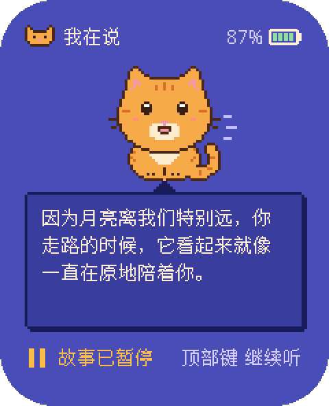
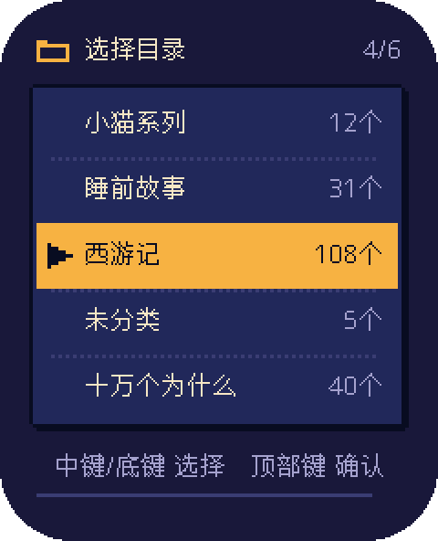

# BOILON S3 Story Player：喵喵故事机固件（非官方）

Unofficial firmware for the BOILON S3 Gen2 children's story player (ESP32-S3). It plays stories from a TF card offline,
and with Wi-Fi a child can talk to Miaomiao, a pixel cat backed by [XiaoZhi](https://github.com/78/xiaozhi-esp32) AI.
The documentation is in Chinese; this is a personal project with no support guarantee.

<table>
<tr>
<td align="center"> 播放故事</td>
<td align="center"> 喵喵陪听</td>
<td align="center"> 和喵喵对话</td>
<td align="center"> 夜灯配色</td>
</tr>
</table>

BOILON S3 二代儿童故事机的非官方固件，基于 [78/xiaozhi-esp32](https://github.com/78/xiaozhi-esp32)（小智）v2.5.2。

## 能做什么

- **离线播放 TF 卡里的故事**：MP3 和 WAV，按目录自然排序，一集播完接下一集；每个文件记住播放位置和音量，开机自动续播。
- **像素界面**：故事卡和喵喵陪听两种播放页，暖纸和夜灯两种配色，可以打开字幕。
- **和喵喵对话**（联网时）：播放中双击顶部键，故事让出声音；聊完从约 5 秒前接着播。可以让喵喵点播卡里的故事、调音量、换屏幕
  样式、暂停、关机或清除播放进度（一个目录或全部，先确认再清）；「回答中插话」默认关，对喵喵说一声就开。
- **播放模式**：对喵喵说「随机播放」「单曲循环」「循环播放」或「顺序播放」，每个目录各记各的，重启后记住；默认顺序播放，
  目录放完就停。
- **没插卡也能聊**；电量低时提示并自动关机；暂停 3 分钟没人动也自动关机。
- **从 TF 卡升级固件**：把新版本拷到卡上，开机自动装；Bootloader 支持回滚，新版本开机就崩溃时退回原来的版本。

功能、按键和硬件的细节见[板子说明](../main/boards/boilon-s3-gen2/README.md)。屏幕上的像素猫叫喵喵；它说话的角色和声音在
xiaozhi.me 的智能体里设置。

## 刷机

固件在 [Releases](https://github.com/AnakinFoxe/boilon-s3-story-player/releases) 里，文件名是 `boilon-ai-player-vX.Y.Z.bin`。
第一次要用 USB：一条命令 `python3 boilon_flash.py install boilon-ai-player-vX.Y.Z.bin` 先整片备份、再写入，出了问题用自己的
备份刷回，步骤见[刷机说明](../docs/boilon/FLASHING.md)。之后从 TF 卡升级。

没存过 Wi-Fi 时，它就是只在本地放故事的播放器：不开 Wi-Fi，也不会自己打开热点。v1.4.0 及更早的 Release 还附有只离线的变体
`-offline.bin`，之后不再提供（2026-10-16）。

## 自己编译

- ESP-IDF v6.1（上游最低要求 v6.0.1、推荐 v6.1）。本仓库发布的固件从 v1.2.1 起用 v6.1 编译（v1.2.0 用 v6.0.2），
  都在设备上验证过（只离线的变体除外）；用别的 IDF 版本编出的固件没有验证过。
- `python3 scripts/build.py boilon-s3-gen2 --name boilon-s3-gen2-ai`，产物是 `build/xiaozhi.bin`。构建可复现：ARM 机器上编出
  的文件逐字节一致；x86 机器（如 GitHub 的 CI）编出的只差固件头里的 ELF 哈希和两个校验值。
- 主机测试：`python3 -m unittest discover -s scripts/tests`。
- 只用 `scripts/build.py` 构建，不要用 `idf.py flash`，原因见板子说明「构建与刷写护栏」。

## 文档

- [板子说明](../main/boards/boilon-s3-gen2/README.md)：硬件与引脚、AI 变体、播放器、按键、SD 卡升级、构建护栏。
- [刷机说明](../docs/boilon/FLASHING.md)：备份、写入、刷回。
- [产品设计](../docs/boilon/DESIGN.md)、[视觉原则](../docs/boilon/UI_STYLE.md)、[像素界面](../docs/boilon/P5_1_PIXEL_UI.md)与
  [每个画面的设计图](../docs/boilon/p5_1_gallery/README.md)。
- [存储与内存](../docs/boilon/MEMORY_MAP.md)、[电量估算](../docs/boilon/M2_BATTERY_BASIS.md)、
  [第三方组件与许可](../docs/boilon/THIRD_PARTY.md)。
- 根目录的 README 是上游小智项目的说明，保持原样，方便以后同步上游。

## 关于这个项目

- 个人项目，按作者自己的需要迭代；不保证支持和兼容，issue 和 PR 不一定回复。欢迎 fork。
- 非官方：与 BOILON、九川、乐鑫或小智服务的运营方没有隶属、授权或背书关系。
- 风险自负：刷机可能让设备开不了机，一定先备份。
- 许可：MIT，与上游相同（见 [LICENSE](../LICENSE)）；本仓库新增的部分 © 2026 AnakinFoxe，同样按 MIT 发布。编进固件的第三方
  组件、字体及其许可见 [THIRD_PARTY](../docs/boilon/THIRD_PARTY.md)，每个 Release 都附许可证全文 `THIRD_PARTY_LICENSES.txt`。
