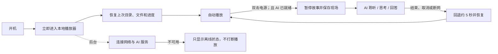

# BOILON S3 第二代故事机产品与交互规格

状态：**首版产品规格已冻结（2026-08-23）**。本文只定义产品形态和用户流程；规格冻结不代表已经开始实现，也不允许跳过安全门槛向实机写入固件。首版视觉方向见 [UI_STYLE.md](UI_STYLE.md)。2026-10-11 按 M3 架构讨论修订了 AI 唤醒、退出与服务器推送规则；同日用户决定删除家长网页，并暂缓唤醒词与「推送播放中不打断」，见文末冻结记录。2026-10-12 再修订：按键表改为实际的按键方向和 ±30 秒组合键；恢复回声消除与回答中插话、AI 点播卡里的内容；删去开机音量渐入和首次开机配网提示，见文末。同日 M5 第五批定下跳过坏文件、低电量、闲置自动关机、WAV 和目录选择方向，见文末。2026-10-15 再修订：每个目录可由喵喵设成顺序播放、目录循环、单曲循环或随机播放，并加上语音暂停与语音关机，见文末。2026-10-16 再修订：喵喵可以清除一个目录或全部的播放进度，见文末。

## 一句话产品定义

这是一台以 TF 卡本地故事播放为常态、以联网小智 AI 为临时交互层的儿童播放器。它不是“离线模式”和“AI 模式”两个需要手动切换的系统：本地播放器始终存在，网络在后台工作，AI 只在可用且被唤醒时暂时取得音频焦点。

## 产品原则

1. **本地播放是基础能力**：没有 Wi-Fi、互联网、账号或云服务时，开机、实体键、TF 卡索引和 MP3 播放仍然完整可用。
2. **网络完全后台化**：联网、重连和 AI 激活不能挡住播放器，也不能自动把孩子带进配网页面。
3. **AI 是临时覆盖层**：AI 对话开始才暂停故事；正常结束、取消、超时或断网都必须回到本地播放器。
4. **儿童操作只依赖三颗实体键**：日常播放不要求触屏、手机或网页。
5. **不做家长后台**：AI 的设置用小智官方控制台；故事内容取出 TF 卡在电脑上拷贝；Wi-Fi 只由实体手势打开限时的临时配网热点，平时不运行管理后台（2026-10-11 修订）。
6. **首版保持克制**：先恢复小智 AI 的基本能力和一个可靠的本地播放器，不加入游戏、信息流、网页传歌、playlist 编辑或复杂自动化。

## 系统不是一个“大模式”状态机

实现时应维护四条相互独立的状态轴：

| 状态轴 | 首版状态 |
| --- | --- |
| 本地媒体 | 未插卡、索引中、用户暂停、播放、被音频焦点挂起、媒体错误 |
| AI 交互层 | 未激活、连接中、就绪、聆听、思考、回答、服务错误 |
| 网络 | 未配置、连接中、局域网已连接但无互联网、互联网可用 |
| 配网热点 | 关闭、开启（实体手势打开，最长 10 分钟） |

网络重连、TF 卡索引和故事播放可以并行。只有音频输出存在唯一所有者，AI 取得音频焦点时才暂时压住本地声音。

## 用户流程一：开机

1. 尽早完成保电、按键、屏幕、音频和 TF 卡初始化，显示简洁播放器界面。
2. 恢复上次使用的目录、文件、播放位置和音量；存在可播放内容时自动续播。
3. 正常保存的断点从记录位置向前回退约 5 秒，避免遗漏上下文；从文件开头起播时不回退。意外断电只能从最近一次持久化检查点恢复，因此实际重复上限是“检查点间隔 + 5 秒”。首版默认每 30 秒保存一次检查点。
4. 开机以保存的音量续播。Codec / 功放的安全工作上限已经实机确认：100 档为九川参考板的最大音量，不破音（M5 第一批）。原厂若有家长最大音量功能则兼容保留，没有则首版不新增。（原定「从静音短暂渐入到保存值」，2026-10-12 用户决定不做：日用没有反映开机太响，以后有需要再做。）
5. Wi-Fi、账号激活和 AI 服务在后台连接。未配置网络或连接失败时，播放页只是不显示喵喵头像（AI 就绪时右上角才有），不播放反复提示音，也不自动开启配网热点。
6. 没有 TF 卡时显示「没有 SD 卡」「请插入或检查 SD 卡」；只要网络、激活和服务连接就绪，在线 AI 仍可独立使用。插卡后自动开始播放属于热插拔（尚未实现，2026-10-13 随 M5 结束移出，见 BACKLOG），现在插卡后要重新开机。

## 用户流程二：本地播放

### 主界面

常态界面只显示：

- 当前目录，也就是故事系列或音乐集合；不是顺序播放时，序号左边有循环、单曲或随机的小图标（2026-10-15）；
- 当前文件名称；
- 播放 / 暂停、进度和时间；
- 音量、电量；
- AI 就绪时的喵喵小头像（不在线时不显示）。

调整音量、切集或切目录时短暂显示覆盖提示，几秒后回到主界面。屏幕熄灭不能停止音频。

### 文件与目录规则

- TF 卡的每个一级目录视为一个 collection；根目录音频归入“未分类”。
- 首版正式支持 FAT32 和 UTF-8 文件名；格式为 MP3 和 WAV（WAV 只认 PCM，其他编码当坏文件跳过；M5 第五批）。
  同一目录里两种格式按完整文件名自然排序，不分格式。
- 目录和文件按自然顺序排列，例如 `第2集` 位于 `第10集` 之前。
- 忽略 `.DS_Store`、AppleDouble、隐藏文件和非音频文件；兼容 macOS 可能产生的 Unicode NFD 文件名。（现在照常收录、
  不做归一化；汉字不受影响，其他字符没有专门验证，见 BACKLOG。）
- 标题首选文件名，不依赖 ID3 标签或封面。
- 每个目录分别保存自己的文件和进度。孩子从音乐切回某个故事目录时，继续该故事原来的断点。
- 单集结束自动播放当前目录的下一集；目录最后一集结束后停止。这是默认的「顺序播放」。2026-10-15 起每个目录可以让喵喵
  改成别的模式，各记各的、重启后记住：
  - 目录循环：最后一集放完回到第一集；
  - 单曲循环：当前这个文件放完从头再放；
  - 随机播放：洗牌，每轮每个文件放一次，放完一轮再洗，不停；随机换到的文件从头放。
  坏文件照旧跳过（单曲循环时换下一个），连续 3 个放不出声音照旧停下。循环、单曲和随机模式下故事不会自己停，所以不会触发
  闲置自动关机。
- 用户暂停后继续从精确位置播放；AI 打断从实时可听位置回退约 5 秒；正常开机从已保存断点回退约 5 秒。
- 进度默认每 30 秒保存一次，并在暂停、切集、切目录和可受控的正常关机时额外保存，避免每秒写 Flash。意外断电最多可能重播约 35 秒。
- 进度可以让喵喵清掉（2026-10-16）：一个目录的，或者整台机器的全部断点记录。清掉的目录以后从第一个文件的开头放；某一集
  单独从头放仍用点播「第 N 集」。音量和播放模式不算进度，不清。

### 三键映射

正面三键从上到下为电源（顶部）、音量加（中间）、音量减（底部）。三键的 GPIO、极性和长按行为已由 P1-3 与日用确认（顶部 GPIO3 高有效，中间 GPIO6、底部 GPIO7 低有效）。2026-10-10 起，切集方向按实物标识：中间键后退、底部键前进（F10）。

| 手势 | 本地播放器中的行为 |
| --- | --- |
| 电源短按 | 播放 / 暂停 |
| 电源双击 | AI 已就绪时唤醒 AI；不可用时只显示短暂提示「喵喵暂时不在线」，不暂停故事 |
| 电源长按约 2 秒 | 保存进度并受控关机 |
| 音量加 / 减短按或连续点击 | 调高 / 调低音量（每次 5 档） |
| 音量加（中间）长按 | 上一集：直接切到上一个文件，从它上次听到的位置接着播（2026-10-12 起不再先回到本集开头）；目录第一集上不动作。目录循环和单曲循环时首尾相接；随机播放时回到刚才放过的那个，从头放 |
| 音量减（底部）长按 | 下一集；目录循环和单曲循环时首尾相接，随机播放时再随机一个，从头放 |
| 按住电源，在关机触发前点音量加 / 减 | 后退 / 前进 30 秒，可连点累计（F04） |
| 同时短按音量加和音量减 | 打开临时目录选择器 |
| 同时长按音量加和音量减约 5 秒 | 打开临时配网热点（最长 10 分钟） |

目录选择器中，音量加（中间）往上、音量减（底部）往下浏览目录（M5 第五批起与按键位置一致），电源短按确认并从该目录的断点播放；约 5 秒无操作则取消并返回原故事。该上下文中的电源键只解释为“确认”，即使连续按也不能唤醒 AI；唤醒词同样暂时禁用。

原草案中的“音量键双击切目录”不再推荐，因为孩子连续按两次调音量时会误切故事。组合键必须由统一的手势识别器判定，保证一次按键序列只产生一个动作。

## 用户流程三：AI 交互

### 进入 AI

AI 只有在完整链路就绪时才算可用，不能只以“Wi-Fi 已连接”判断。入口有两个：

1. 本地唤醒词，例如“你好喵喵”；只在故事没有播放（暂停、目录播完或无卡）时监听，故事播放中麦克风关闭。（2026-10-11 用户决定暂缓：首版只用双击进入；以后有很强的必要再做。）
2. 双击电源键：AI 就绪时随时可用，也是故事播放中唯一的进入方式；没有 TF 卡时同样可用。

成功进入时：

1. 保存当前目录、文件、孩子已经听到的播放位置，以及进入前是否正在播放；
2. 暂停本地解码并排空尚未送到扬声器的本地 PCM；
3. 显示小智风格的聆听、思考和回答界面；
4. 恢复官方小智的首版基线：配网与激活、唤醒词 / 按键进入、聆听、连续对答、TTS、打断 / 取消和断线重连；不在首版叠加复杂新功能。

### 退出与恢复

- 孩子说要回到故事（由 AI 调用本机的「回到故事」工具）、按键取消、服务器结束对话、认证失败、服务器断开或网络中断都走同一个退出流程。不设本机静默超时：服务器不结束对话时，设备一直等待孩子说话。
- 进入 AI 前若故事正在播放，则从保存位置向前约 5 秒恢复；进入前若处于暂停，则仍保持暂停。故事应在 AI 结束后 1–2 秒内恢复出声。
- 已结束会话的迟到响应必须被丢弃，不能在故事恢复后突然发声。
- AI 可以控制本地播放器（2026-10-12 起，P5-2 第一批）：孩子请喵喵放卡里的某个目录或某一集，喵喵说完就切过去，之后照常往下播；只放卡里的内容，不按内容跳到文件中间。AI 修改了播放器状态时新命令优先，退出时不再恢复旧快照（原来那个故事的断点保留）。
- 2026-10-15 起喵喵还能：把一个目录设成顺序播放、目录循环、单曲循环或随机播放（不说目录就是正在放的那个，对话照常继续）；
  孩子说「先别放了」，喵喵说完这句就结束对话，故事保持暂停；说「关机」，喵喵说完就保存进度关机，没卡时也一样。
- 2026-10-16 起喵喵还能清除播放进度（一个目录，或者全部）：先复述要清什么，对方说好了才清，因为清掉的找不回来；故事机把关，
  喵喵问过之后，要再收到对方的一句话才真的清。清的包括
  正在听的目录时，喵喵说完这句就结束对话，这个目录从第一个文件的开头放，和点播第 1 集一样；清的是别的目录时，对话照常继续。

AI 交互期间：

- 音量键短按继续调整音量（AI 与故事共用同一个音量）；
- 切集和切目录手势暂时禁用；
- 电源短按立即取消 AI 并回到播放器；
- 电源长按仍然关机。

### 离线行为

- 网络、账号或 AI 服务未就绪时，唤醒词和双击电源都不能取得音频焦点。
- 本地故事不暂停，也不反复播放“网络不可用”提示；只短暂显示“AI 离线”或“AI 连接中”。
- 网络恢复后 AI 在后台重新变为可用，不重启播放器。
- 故事播放中不监听唤醒词，因此不需要在故事声音里识别唤醒词。AI 回答时的插话依赖回声消除（P5-3 第一批）：默认关，对喵喵说「打开回答中插话」才开，重启后记住；关着时用电源短按取消。双击电源始终保留为可靠入口。

## 用户流程四：设置与内容管理（2026-10-11 修订：不做家长网页）

用户决定删除原定的本机家长网页（局域网页面、一次性 PIN、WPA2 一次性密码热点、状态页和设置事务），
改为：

- **AI**：激活、智能体和对话相关设置直接用小智官方控制台（xiaozhi.me）。设备屏幕只在需要时显示激活码。
- **故事内容**：取出 TF 卡，在电脑上拷贝或删除文件后插回，重新开机即可。设备始终只读 TF 卡。
- **Wi-Fi**：同时长按音量加和音量减约 5 秒，打开上游的临时配网热点，屏幕显示热点名；用手机连上后在
  配网页填写家庭 Wi-Fi。热点最长开 10 分钟，不自动打开；按上游实现没有密码，按家用场景接受。
- **目录末尾循环**：原定由家长页设置，2026-10-11 取消；2026-10-15 起改为对喵喵说，每个目录可设顺序播放、目录循环、
  单曲循环或随机播放，见「文件与目录规则」。

## 异常行为

| 情况 | 预期行为 |
| --- | --- |
| 未插卡、空卡或坏卡 | 不重启、不格式化；显示原因，只要联网链路就绪，在线 AI 继续工作 |
| 索引中 | 显示进度；按键和网络任务保持响应。（现在显示「正在检查」页，没有进度） |
| 单个文件损坏 | 跳过并记录错误：像播完一样切到下一个，目录最后一个就停下；连续 3 个坏文件就停下，显示「播放错误」，仍能选别的目录、按播放再试或让喵喵点播；其中有打不开或读不了的（卡的问题，例如拔卡）才停到「读卡出错」页。（M5 第五批，2026-10-13 修正） |
| 保存的文件被移动或删除 | 在原目录寻找最近的可播放文件，否则回到该目录第一集。（尚未实现，2026-10-13 随 M5 结束移出，见 BACKLOG） |
| 播放中拔卡 | 有卡检测时立即处理；否则在读错误或轮询发现后停止解码、释放句柄并显示“TF 卡已拔出”。（现在读错误后按坏文件跳过，连续 3 个放不出声音时停到「读卡出错」页；热拔卡见 P5-5） |
| AI 期间拔卡 | AI 可完成；退出后显示无卡，不尝试恢复已不存在的文件。（现在没有拔卡检测：对话照常结束，之后接着播时读不出，按上面两行处理；热拔卡见 P5-5） |
| 重新插卡 | 后台挂载并重建索引，不抢占正在进行的 AI；若当时停在无卡页，则索引完成后按保存断点自动播放。（尚未实现：现在要重新开机；2026-10-13 随 M5 结束移出，见 BACKLOG） |
| Wi-Fi 已连但无互联网 | 本地播放不受影响；AI 标为不可用并后台重试 |
| AI 中途断网 | 立即结束 AI 覆盖层并按规则恢复本地播放 |
| 低电量 | 估算电量降到 10% 时提示一次「电量低，请充电」；连续约 15 秒不高于 3% 就保存进度、显示「电量低」并受控关机。不能判断是否在充电。（M5 第五批） |
| 长时间不用 | 没有声音在放（暂停、目录播完或停在没卡页）、没有对话、3 分钟没按键，就保存进度并受控关机。（M5 第五批，用户提出）循环、单曲和随机模式下故事一直在放，不会触发；可以对喵喵说「关机」。（2026-10-15） |
| NVS 快满 | 开机时可用条目少于一页就这次不开 Wi-Fi 和配网热点；故事照常、照常存断点。（M5 第五批） |
| 上游停在升级状态 | 满 1 分钟就保存进度并受控关机。（M5 第五批） |
| 网络重连或更新检查 | 不播放语音，不抢音频焦点，不在播放中静默刷固件 |
| SD 卡上有更新版本的固件 | 只在开机、开始播放之前检查卡根目录：有更新的 `boilon-ai-player-vX.Y.Z.bin` 就显示「正在升级」和进度，写进另一个槽、校验后切换并重启，新版本先显示约 3 秒「升级完成」；写入或校验失败显示「升级没有成功」，照常用原来的版本开机。电量低于 20% 时不升级。（M7，AI 变体） |
| 服务器主动推送的声音（通知、提醒音、不请自来的回复） | 故事播放中一律不打断；故事暂停时允许播放。（2026-10-11 暂缓实现：目前推送会打断正在播的故事，结束后故事自动从约 5 秒前接着播。） |

## 隐私与安全

- 只有真正进入 AI 会话后才上传麦克风音频；故事播放中麦克风关闭。（原定的本地唤醒词检测已暂缓。）
- AI 正在聆听 / 上传时显示明确的麦克风状态。（打开回答中插话后，喵喵说话时麦克风也在上传，画面显示的仍是「我在说」。）
- 设备日志不记录孩子说的话和 AI 的回答。
- 临时配网热点只由实体手势打开、最长 10 分钟；配网页不显示 OTA 地址项。设备不提供其他网页或管理端口。
- 移除现有“NVS 初始化失败就擦除整个 NVS”的回退路径。
- 当前 Flash Encryption 未启用；以上措施防护邻近无线访问，不防拿到设备后直接读取 Flash 的物理攻击者。首版不因此烧写不可逆安全 eFuse。

## 冻结记录

已经确认：目录末尾默认停止并可由家长页改为循环；同时短按音量加减进入目录选择器；没有 TF 卡时仍可独立使用在线 AI；AI 中短按电源立即取消并返回播放器；家长页采用局域网优先、临时热点兜底，只提供状态和设置。

2026-10-11 修订（用户确认）：唤醒词只在故事未播放时监听，播放中用双击电源进入 AI；取消本机静默超时，保持连续对话，直到孩子要求回到故事、按键取消或服务器结束；服务器主动推送的声音不打断正在播放的故事；AI 结束后 1–2 秒内恢复故事。

2026-10-11 再次修订（用户决定）：删除家长网页，AI 用小智官方控制台，故事内容取卡拷贝，Wi-Fi 用手势打开的
临时配网热点，目录末尾循环不再提供；暂缓唤醒词和「推送播放中不打断」，以后有很强的必要再做，首版只用
双击进入 AI。上面第一段中与此不符的部分以本段为准。

2026-10-12 修订（用户决定）：恢复回声消除与回答中插话（P5-3，默认关、对喵喵说一声就开、重启后记住）和 AI 控制
播放器（P5-2，只放卡里的内容；后退键直接切到上一个文件）；按键表按 2026-10-10 起的实际按键方向和 ±30 秒组合键
更新；删去开机音量渐入（日用没有反映开机太响）和首次开机的配网提示（这台设备已存 Wi-Fi），两项都留到以后，
有需要再做。上文与此不符的部分以本段为准。

2026-10-12 修订（M5 第五批，用户批准）：坏文件跳过、连续 3 个放不出声音才停；低电量 10% 提示一次、3% 关机；
闲置 3 分钟自动关机；支持 WAV；目录选择器里中间键往上、底部键往下。上文已按此更新。

2026-10-14 补记（M7 收尾·文档与清理）：异常行为表加上 M7 已实现的 SD 卡升级；NFD 文件名与「AI 期间拔卡」注明现在的
做法。行为本身没有改变。

2026-10-15 修订（用户决定）：恢复目录末尾循环，改成对喵喵说、每个目录各记各的四种模式（顺序播放仍是默认，另有目录循环、
单曲循环、随机播放），重启后记住；随机是洗牌，随机换到的文件从头放；屏幕在序号左边显示模式小图标。加上语音暂停和语音关机。
同时提出的睡眠定时、跳过片头、熄屏和音量上限这次不做（见 BACKLOG）。上文已按此更新。

2026-10-16 修订（用户决定）：喵喵可以清除一个目录或全部的播放进度，先复述、对方说好才清；正在听的目录被清时，喵喵说完
这句就结束对话，这个目录从第一个文件的开头放；音量和播放模式不算进度，不清。第一轮上机发现喵喵有一次问完没等回答就清了，
用户决定由故事机把关：她问过之后，要再收到对方的一句话才清。上文已按此更新。

开机行为定义为“有可播放内容就自动续播”，而不是记忆上次的播放 / 暂停意图。视觉采用原创的 90 年代掌机像素语言，中文可读性和克制动效优先；具体细节允许在实机演示后调整，见 [UI_STYLE.md](UI_STYLE.md)。后续若改变这些行为或核心视觉原则，应先修订对应文档，再进入实现。
