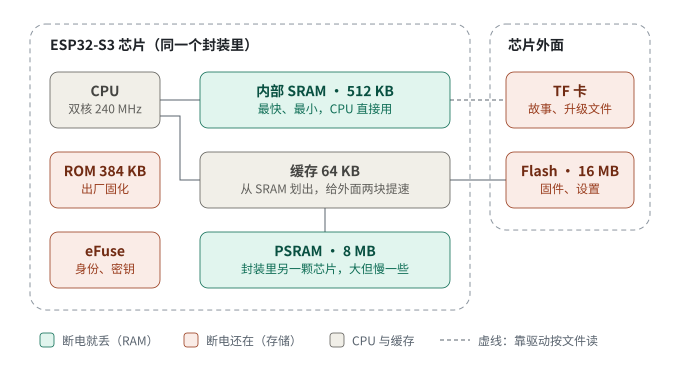
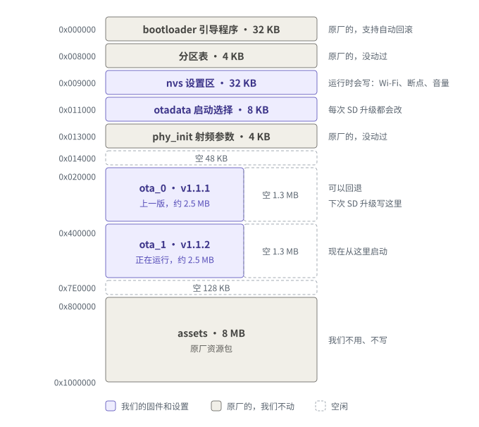
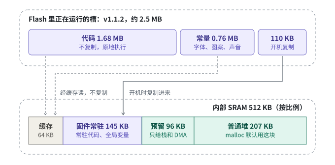
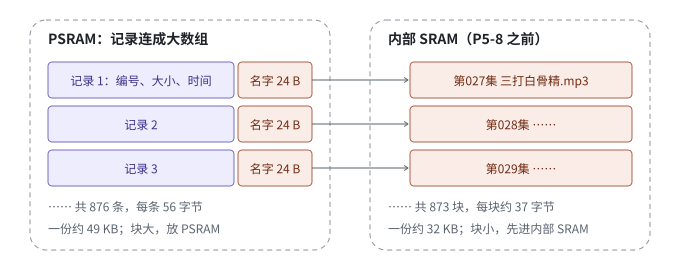

# 存储与内存：这台设备上的 RAM、Flash 和 TF 卡

这篇讲清楚 BOILON S3 第二代上都有哪些存储、各放什么、固件存在哪，以及开机之后这些存储怎么被使用。最后用「卡上目录表」为例，算一遍内部 SRAM 为什么会不够、P5-8 是怎么修的。

数字的来源（2026-10-14 整理）：

- 芯片、Flash 与 PSRAM 型号：[板子说明](../../main/boards/boilon-s3-gen2/README.md)与开机日志；
- 固件大小和分段：v1.1.2 AI 变体的发布文件（`ba1da414`）；
- 开机时内部 SRAM 和 PSRAM 怎么划分：v1.1.2 开机日志里的 `heap_init` 与 `esp_psram` 行；
- 目录表和开机各阶段的内存变化：2026-10-12 的诊断版 `5abef851`（卡上 876 个文件）；修好之后的最低值来自 P5-8 第一批 `3d3decfb` 与 v1.1.2 的日志。

固件以后有变化，这些数字也会小幅变化；重新量的方法见最后一节。

## 先说结论

「RAM」是统称，指断电就丢的工作内存。这台设备上有两块 RAM：

- **内部 SRAM**：做在 ESP32-S3 芯片里面，512 KB。最快，CPU 直接用，但很小。文档和日志里说的「内部 RAM」「内部 SRAM」「internal」都是它。
- **PSRAM**：8 MB，是和主芯片封装在一起的另一颗小芯片（日志认出是 AP Memory 的 64 Mbit 八线 PSRAM）。容量大，但要经过缓存访问，慢一些。代码和日志里也叫 SPIRAM 或外部 RAM。

两个名字的来历：

- **SRAM**（static RAM）的每一位用一组晶体管锁住，不需要刷新，所以快；但很占芯片面积，做不大。
- **PSRAM**（pseudo-static RAM，「伪静态」）里面其实是靠电容存数据的 DRAM，需要不停刷新。它自己在内部做刷新，对外看起来像 SRAM，所以便宜、容量大、慢一些。

在这台设备上说「内存不够」，几乎总是指内部 SRAM；PSRAM 平时大部分空着（实测空着 7 MB 多）。

## 一、设备上有哪些存储

| 名字 | 大小 | 断电后 | 放什么 |
| --- | --- | --- | --- |
| 内部 SRAM | 512 KB | 丢 | 正在用的数据、任务栈、硬件收发缓冲 |
| PSRAM | 8 MB | 丢 | 大块数据：屏幕画布、故事文件的读取和解码、回声消除等 |
| Flash | 16 MB | 在 | 两个固件槽、设置（NVS），以及原厂留下的引导程序和资源包 |
| TF 卡 | 看卡 | 在 | 故事文件；SD 升级时也放新版本的固件文件 |
| ROM | 384 KB | 在，只读 | 乐鑫出厂固化的启动代码，谁都改不了 |
| eFuse | 512 字节 | 在，只能烧一次 | MAC 地址、安全开关、厂家写入的序列号和激活用的密钥 |
| RTC 内存（图里没画） | 16 KB | 丢，深度睡眠时保留 | 我们基本没用；其中 7 KB 被系统当普通内存用 |

它们之间的关系，记住三条就够了：

1. CPU 能直接访问的只有内部 SRAM。
2. Flash 和 PSRAM 挂在芯片的外部总线上：Flash 是 4 线，PSRAM 是 8 线，都跑 80 MHz。CPU 通过 MMU 把它们映射成内存地址，读的时候先查缓存。缓存是从 512 KB 内部 SRAM 里划出来的 64 KB（指令和数据各 32 KB），没命中才去外部芯片取。所以程序可以直接在 Flash 里运行，不需要整个搬进 RAM。
3. TF 卡不能映射。它只能靠 SD 驱动加 FAT 文件系统，按文件一块一块读进 RAM。

另外，屏幕的 JD9853 控制器自己也有一块显存，用来保存当前画面，所以每次只需要把变化的那几行发过去。

## 二、Flash 分区：固件存在哪

图里的小分区画大了，不按比例。分区表沿用原厂的布局（[`partitions/boilon-s3-gen2.csv`](../../partitions/boilon-s3-gen2.csv)），从没改过。

- **两个固件槽轮流用。** `ota_0` 和 `ota_1` 各 3.875 MB。现在 `ota_1` 跑 v1.1.2，`ota_0` 留着上一版 v1.1.1。SD 卡升级总是写进没在运行的那个槽，校验通过后改 `otadata` 切过去；所以下一次升级会写 `ota_0`，再下一次又回到 `ota_1`。
- **原厂固件已退役。** M7 第一次 SD 升级覆盖了原厂 2.0.5 所在的 `ota_0`。原厂固件只剩刷机前读出的 16 MB 整片备份。
- **原厂留下的部分。** 引导程序、分区表、`phy_init` 和 8 MB 的 `assets` 都是原厂的，我们不写。原厂引导程序支持自动回滚（M7 实测）。我们的固件把要用的字体和图案直接编进程序（`CONFIG_FLASH_NONE_ASSETS=y`），不读 `assets`。
- **`otadata`** 记录从哪个槽启动，以及新装的版本是否已经确认。每次 SD 升级都会改它。
- **`nvs` 是「设置抽屉」**：Wi-Fi 密码、设备身份（uuid）、播放断点和书签（音量存在同一条记录里），还有插话开关 `bl_ai/barge_in`。平时会写的 Flash 只有这一块；SD 升级时，另外会写一个固件槽和 `otadata`。

## 三、开机：固件怎么进内存

开机顺序：

1. 按下电源键，ROM 里的代码先运行，把 Flash 0x0 处的引导程序读进内部 SRAM。
2. 引导程序读分区表和 `otadata`，选出要启动的槽并校验固件。如果这个槽是刚升级上去、还没确认的版本，而上一次开机没等到确认就重启了，引导程序会退回另一个槽（自动回滚）。
3. 装载固件。只有约 110 KB 会复制进内部 SRAM：必须常驻的代码（中断处理、写 Flash 时还得运行的驱动等），加上全局变量的初值。其余约 2.4 MB 不复制，靠 MMU 映射，用到哪里就经缓存从 Flash 读哪里。
4. 固件初始化：
   - 把约 31 KB 的全局变量区清零；
   - 认出 PSRAM（日志里的 `Found 8MB PSRAM device`）；
   - 把内部 SRAM 剩下的约 303 KB 和整块 8 MB PSRAM 交给内存分配器（`malloc` 用的就是它）；
   - 从内部 SRAM 里预留 96 KB（`CONFIG_SPIRAM_MALLOC_RESERVE_INTERNAL`），只给显式要内部内存的申请用，比如任务栈和 DMA 缓冲；普通 `malloc` 拿不到。
5. 进入我们的代码：
   - 点亮屏幕，显示「正在检查」和版本号；初始化 NVS；
   - 挂载 TF 卡。AI 变体先看卡根目录有没有更新的发布文件，有就写进另一个槽、切换并重启（见[板子说明](../../main/boards/boilon-s3-gen2/README.md)）；
   - 扫描目录表，读出断点、音量和插话开关等设置，开始播放；联网，连上 xiaozhi.me。
6. 启动完成（开始播故事，或显示没有故事的页面）时，刚升级上来的版本确认自己有效，之后就不会再被回滚。

上图下半部分按比例画了 512 KB 内部 SRAM：

- 64 KB 给缓存；
- 约 145 KB 是固件常驻部分：开机复制进来的 110 KB、清零的约 31 KB 全局变量，加上 ROM 保留的约 4 KB；
- 剩下约 303 KB 是堆，其中 96 KB 是上面说的预留。

## 四、运行时谁住在哪

- **内部 SRAM 的堆**放这些：
  - 任务栈；
  - DMA 缓冲（DMA 就是硬件自己搬数据）：屏幕每次发 8 行用的 3.75 KB，还有音频 I2S 和 TF 卡用的；
  - Wi-Fi 收发缓冲；
  - 所有不超过 2 KB 的小块 `malloc`。
- **PSRAM** 放大块：屏幕前后两张 240×296 的画布（各约 69 KB）、故事文件的读取和解码缓冲、回声消除（AFE 设成尽量用 PSRAM）、TLS 加密缓冲；P5-8 之后，卡上目录表的三份也全在这里。

分配规则来自 `CONFIG_SPIRAM_MALLOC_ALWAYSINTERNAL=2048`：一次申请不超过 2,048 字节的，先给内部 SRAM；超过的，先给 PSRAM；哪边不够，再借另一边。显式指定内存类型的申请（任务栈、FreeRTOS 的队列和信号量、DMA 缓冲等）不走这条规则。

有些东西非放内部 SRAM 不可：DMA 缓冲、任务栈，还有写 Flash 时仍要响应的中断代码和数据。写 Flash（比如保存书签）的那一刻，缓存要暂停，Flash 和 PSRAM 都暂时访问不了，所以这些只能放在内部 SRAM。

因此内部 SRAM 一旦见底，新建任务、Wi-Fi 收包、DMA 都会失败，表现出来就是掉线、卡顿或重启。这就是开发中一直盯着「最低内部 SRAM」、并把 40 KB 定为停止线的原因。

现在的水平：

- P5-8 之后，对话中最低 122,823 bytes（`3d3decfb`）；
- M7 第二次 SD 升级那次的日志里，最低 120,283 bytes。

日志里看这个数：上游 `SystemInfo` 定期打印 `free sram: … minimal sram: …`。前者是当前空闲的内部 SRAM，后者是开机以来的最低值。

## 五、例子：卡上目录表的这笔账（P5-8）

2026-10-12 合装 `76e3832c` 之后，对话中内部 SRAM 最低只剩约 29 KB，低于 40 KB 停止线。查下来，原因是卡上的目录表。

图里的文件名是举例，不是卡上的真实文件。图中的两点：

- 每个文件对应一条 56 字节的记录：编号 16、名字外壳 24（C++ 的 `std::string` 对象）、大小 8、修改时间 8。同一个目录的记录连成一个大数组，876 条约 49 KB。大块本来就放在 PSRAM，这部分一直没问题。
- 不超过 15 字节的名字，直接存在外壳里。更长的名字，外壳里只放一个指针，名字本身要另外申请一小块内存。中文在 UTF-8 里每个字占 3 字节，名字很容易超过 15 字节，比如「第027集 三打白骨精.mp3」就有 29 字节。卡上 876 个名字里，有 873 个超过了 15 字节。

一份目录表的名字小块（前两行数字来自诊断日志的 `Diag catalog` 行）：

| 项目 | 数字 |
| --- | --- |
| 873 个名字本身（含结尾的 0） | 27,445 字节，平均每个 31.4 字节 |
| 堆分配器给每块加 4 字节记账，再补齐到 4 的倍数 | 平均每块约 5.5 字节，共约 4.8 KB |
| 一份合计 | 约 32.2 KB（实测第 2、3 份平均每份 32.7 KB） |
| 三份 | 实测 33.6 KB + 65.4 KB ≈ 99 KB |

「每块不到 2 KB」只是说它们都算小块，按规则先进内部 SRAM；实际每块只有三十几个字节。三份的大数组另外在 PSRAM 里占了约 170 KB。

开机各阶段的空闲内存（诊断版 `5abef851`，P5-8 之前）：

| 时刻 | 内部 SRAM 空闲 | PSRAM 空闲 |
| --- | --- | --- |
| 扫描 TF 卡前（开机后 1.52 秒） | 213 KB | 7.8 MB |
| 扫描后，生成第 1 份目录表（2.02 秒） | 179 KB | 7.7 MB |
| 断点线程复制出第 2、3 份（2.04 秒） | 114 KB | 7.7 MB |
| 断点线程启动（分走任务栈） | 101 KB | 7.7 MB |
| 联网、连上 MQTT 之后 | 约 42–51 KB | 7.4 MB |
| 对话中最低 | 约 29 KB | — |

**为什么有三份。** 播放器、文件书签（最近 32 个文件的播放位置）和续播策略各持有一份完整的目录表。后两个在断点线程里，这是一个单独负责写 NVS 的后台任务，好让播放器不用等 Flash。

当初各持一份快照，是为了三件事：模块能单独做主机测试；不同任务之间不共享数据，不用加锁；以后重新扫描时，后台任务手里不会留下指向旧目录表的指针。那时卡上约 90 个文件，三份加起来才约 10 KB。三方共用一份是以后的事，建议和热拔卡一起做。

**P5-8 的修法。** 在两个很短的窗口里，用 `heap_caps_malloc_extmem_enable(0)` 把 2 KB 门槛临时改成 0，让小块也先去 PSRAM；窗口一结束，马上改回 2048。两个窗口是：

1. 扫描 TF 卡，约半秒，生成播放器那一份；
2. 创建断点线程，约 20 毫秒，复制出书签和续播那两份。

代码在两个变体主文件里的 `CatalogInPsram()`。副作用都很小：

- **读名字稍慢。** 只有换集、每 30 秒存进度、开机恢复断点、喵喵列目录或搜关键词时才读名字，每次微秒级；播放路径不碰名字。
- **开关是全局的。** 窗口里，别的任务申请的小块也会先放 PSRAM。显式要内部内存的（任务栈、队列和信号量、DMA 缓冲、Wi-Fi 驱动的收发缓冲）不受影响。普通对象和网络缓冲落到 PSRAM，是 ESP-IDF 支持的用法（`CONFIG_SPIRAM_TRY_ALLOCATE_WIFI_LWIP` 就是让它们优先用 PSRAM），只是稍慢。
- **必须改回来。** 两处都在窗口结束时立刻恢复，扫描后的恢复早于不会返回的出错页；有主机测试检查这几处接线。
- **PSRAM 多用约 0.1 MB，可以忽略。** PSRAM 不够时，`malloc` 会自动改用内部 SRAM，不会崩溃。

为什么不干脆全局调小门槛：小块往往访问频繁，全局调小会把它们统统挪到较慢的 PSRAM，影响面和风险都大得多。窗口做法只动目录表这一处。

修好之后，用同一张卡，对话中内部 SRAM 最低 122,823 bytes（`3d3decfb`）。

## 六、怎么重新量这些数字

- **固件分段**：`python -m esptool --chip esp32s3 image_info --version 2 <app.bin>`（esptool 4.x）。`IROM` 是在 Flash 里原地运行的代码，`DROM` 是常量，`IRAM` 和 `DRAM` 两类是开机复制进内部 SRAM 的部分。
- **静态内存**：构建后，在 ESP-IDF 的 Python 环境里运行 `python -m esp_idf_size build/xiaozhi.map`。
- **开机日志**：`heap_init: At …` 几行是内部 SRAM 交给堆的几段；`esp_psram:` 几行是 PSRAM 的型号、速度和 96 KB 预留；运行中看 `free sram: … minimal sram: …`。
- 原始串口日志里有设备序列号和激活信息，往文档里只摘内存这几行。
