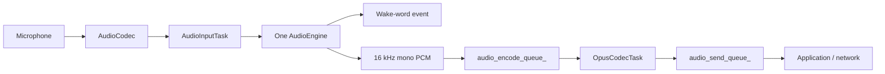

# Audio Service Architecture

`AudioService` owns one input engine and keeps codec I/O, Opus encoding/decoding,
and network queues independent from the chip-specific speech pipeline.

## Input engines

The old `AudioProcessor + WakeWord` combinations have been replaced by a single
`AudioEngine` interface. `AudioInputTask` reads PCM once and feeds exactly one
engine.

| Target | Engine | Wake word | Uplink processing |
| --- | --- | --- | --- |
| ESP32-S3 / ESP32-P4 / ESP32-S31 | `AfeAudioEngine` | WakeNet inside AFE, or MultiNet fed from AFE output | FD AEC + VAD when audio processing is enabled |
| ESP32 / ESP32-C3 / ESP32-C5 / ESP32-C6 | `LiteAudioEngine` | Standalone WakeNet when configured | Raw mono PCM |

`AfeAudioEngine` owns a single FD AFE instance. WakeNet and voice uplink share
that instance, so enabling both no longer creates two AFE pipelines. For custom
MultiNet wake words, AFE fetch output is passed to `CustomWakeWord`; MultiNet is
not created on the smaller targets.

The AFE configuration currently uses `FD_LOW_COST` AEC with
`AEC_NLP_LEVEL_VERYAGGR`. WebRTC/NSNet noise suppression is intentionally
disabled because the project does not ship an NSNet model.

When wake-word audio upload is enabled, the most recent two seconds of PCM are
stored in a single 64 KB PSRAM ring buffer. WakeNet and MultiNet share the same
cache implementation, and the encoder reads it one Opus frame at a time. This
avoids the previous per-chunk internal-SRAM allocations and temporary PCM
concatenation buffer.

## Input data flow

### Board input layouts

Built-in boards default to one microphone: `M` without a playback reference, or
`MR` when the codec supplies a playback reference. `R` must contain playback
reference samples, not a second microphone. The channel declaration must match
the interleaved PCM returned by the codec.

Multiple-microphone input remains available for developer experiments; the AFE
still derives its format from the codec's microphone and reference counts.
For Box Lite, the final `BoxAudioCodecLite` constructor parameter is
`microphone_channels`, defaulting to `1`. Pass `2` explicitly to test `MMR`
with reference enabled, or `MM` without it. `EnableInput()` and `Read()` use this
count for capture and interleaving. On ESP32-S31-Korvo-1, developers can change
the board's `AUDIO_INPUT_CHANNELS` from `1` to `2` to test `MM`; its codec has no
playback reference. Neither experimental layout is enabled in default builds.

Single-microphone defaults do not imply that ESP-SR FD lacks dual-microphone
support, or guarantee hardware operation. Validate capture, playback, wake/VAD,
interruption, reconnect, and applicable AEC modes on the affected board before
releasing a change. Box Lite's software playback reference also needs timing
and concurrency validation.

Wake-word detection and voice processing are independent runtime states on the
same engine. On AFE targets, AEC stays active while wake-word detection is active
so playback reference remains available for wake-up during device playback. It
also stays active during voice processing when device AEC is requested.

## Output data flow

## Tasks and power management

- `AudioInputTask` reads codec input and feeds the selected engine.
- `AudioOutputTask` drains decoded PCM to the codec output.
- `OpusCodecTask` encodes uplink PCM and decodes downlink packets.
- `AfeAudioEngine` has its own AFE fetch task on S3/P4/S31.

The audio power timer still enables and disables codec ADC/DAC channels based on
activity; the engine refactor does not change that policy.

## Local MP3 producer (Boilon)

`InitializePlaybackOnly(codec)` is a fresh-instance opt-in for PCM-only players.
It creates the normal power timer and starts the caller's Codec, but does not
construct an input engine, input resampler or Opus codecs. On success, call
`Start()` once: only the existing `AudioOutputTask` is created. Timer/task startup
failure leaves the service stopped, so `BeginLocalPlayback()` returns zero.
`Stop()` is terminal in this mode, including before Start; a failed initialization
attempt that selected this mode cannot be retried or switched to voice mode.
The Codec, service and worker must retain their normal lifetime relationship;
initialization and Start/Stop are single-owner operations, not concurrent calls.

This mode accepts local PCM only. Opus packets, OGG sounds, input reads and audio
testing do not start input/output side effects; wake/VAD remain unavailable with
no input engine. Existing `Initialize(codec)` users keep the normal voice engine
and three-task pipeline. No board-specific conditions are added to AudioService.

`LocalMp3Player` reads an already-resolved file in one cancellable worker, decodes
with the pinned ESP Simple Decoder, downmixes/resamples and submits <=960-sample
PCM blocks to the existing two-entry playback queue. It never writes the codec.
`AudioService` grants an exclusive generation-bound local session only while idle;
protocol input is rejected until that session ends. Pause retains queued frames;
stop/reset invalidates old frames. One already in-flight codec block may finish.
Controls are single-owner and nonblocking; AudioService must outlive the player
and worker. Both Boilon variants use the local session: the local-library entry
through `InitializePlaybackOnly()`, and the AI variant's story player beside
XiaoZhi on the normal voice-mode service. See the
[board README](../boards/boilon-s3-gen2/README.md) for the player's behavior.

A file named `.wav` skips the decoder: it is read as PCM WAV (`main/media/wav_format.h`:
8-32-bit integer or 32-bit float, mono or stereo, 8-48 kHz), and other WAV encodings
fail like a bad MP3. After an error, `ReadFailed()` tells a file the card could not
open or read from content the decoder or the WAV reader rejected.

`LocalMp3Player::StartAt(path, ms)` scans actual frame lengths up to the target
(never estimating offsets from the bitrate), then decodes and discards a bounded
preroll; layouts it does not recognize fall back to decoding and discarding the
whole prefix. Frames seen earlier in the same file (about 3.5 minutes at 44.1 kHz)
let a later seek start close to the target. File reads go through an 8 KB stdio
buffer in sequential aligned blocks. `PositionMs()` counts only completed codec
output, plus the seek origin; physical DMA latency remains unmeasured.
`DurationMs()` is zero until EOF; a fast seek counts the prefix frames. A WAV seek
jumps straight to its sample, and its duration comes from the header. Scanning
and discarding yield periodically, so stop/pause still work. Existing
`Start(path)` remains a zero-position start. Bookmarks belong to the board
(`bl_resume/state_v2`, see the
[board README](../boards/boilon-s3-gen2/README.md)); this audio API never touches NVS.
## Queue and allocation policy

The service queues use compile-time fixed-capacity storage. Their existing drop,
wait, and playback-drain policies remain unchanged, but queue growth no longer
allocates deque nodes. `AudioTask` values are stored directly, and Opus encoding
writes into the packet payload instead of allocating a second temporary output
buffer. Packet and PCM buffer pools should only be added after target-side heap
and latency measurements justify their additional ownership complexity.
